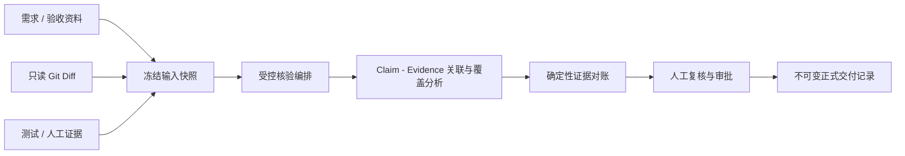

# AI-CodeReview

> 面向研发交付的多源证据核验与交付记录平台。

AI-CodeReview 不是以模型意见替代人工判断的通用代码审查工具。它将需求、验收标准、只读 Git Diff、测试或人工补充证据固定为一次核验的输入快照；模型负责提取和关联候选，确定性规则与人工审批共同决定正式结论，并将发布后的交付记录固化为可回放的版本化记录。

## 项目定位

研发交付常见的问题不是缺少代码，而是“这次提交是否真的满足需求、证据是否完整、谁作出了最终确认”难以追溯。本项目面向研发团队，将交付核验从一次性的模型问答，收敛为可审计的协作流程：

- 以需求、验收材料、Git Diff 和测试/人工证据为事实来源；
- 以 `Claim`（交付主张）和 `Evidence`（证据）表达关联关系；
- 以冻结快照、版本化报告和不可变正式记录保留核验过程；
- 以角色权限与人工审批约束发布，避免模型结果直接成为正式结论。

## 核心核验流程与边界



模型在流程中只提供结构化的候选提取、关联建议、代码理解和风险提示；它不能直接发布报告、修改 Git、执行仓库代码或绕过权限规则。正式状态由后端校验、已冻结的证据范围、确定性对账和人工审批共同决定。

固定核验核心包括：

- `requirement-claim-core`：从需求和验收材料形成可核验的交付主张；
- `delivery-git-diff`：以冻结 SHA 的只读 Git Diff 作为代码交付证据；
- `evidence-reconciliation`：使用确定性规则输出最终的证据状态与覆盖结论。

自定义 Agent 只能作为 `SHARED` 的外围能力运行，不能替代上述固定核心或改变最终裁决。

## 已实现能力

- 项目、成员与 RBAC：`SUBMITTER`、`REVIEWER`、`ADMIN` 三类角色；提交者不能审批自己的报告。
- 多源材料与知识检索：资料版本、来源角色、全文检索、pgvector 向量检索与可解释的混合排序。
- 交付证据链：冻结需求/验收资料、Git SHA/Diff、测试与人工证据，并以 Claim/Evidence 关系组织核验事实。
- 受控 AI 核验：基于 LangGraph 的固定编排、Pydantic 结构化输出、允许的 ID 范围与快照约束；模型输出仅作为候选。
- 代码上下文补充：通过 Tree-sitter 和冻结目标 SHA 缓存补充关联符号与一跳导入，补充内容标记为 `CONTEXT_ONLY`，不成为正式证据。
- 任务可靠性与审计：独立 Worker 使用租约、心跳、超时、取消和重试机制执行分析任务；输入、模型配置、提示词和报告均具备版本化/快照化记录。
- 报告审批与发布：核验报告经受权人员审批后，发布为不可变的正式交付记录。

## 技术栈

| 层次 | 技术 |
| --- | --- |
| 前端 | Vue 3、TypeScript、Vite、Vue Router、Pinia |
| 后端 | Python 3.12、FastAPI、Pydantic、SQLAlchemy、Alembic |
| 数据与检索 | PostgreSQL 16、pgvector、PostgreSQL FTS |
| AI 编排与代码理解 | LangGraph、Tree-sitter |
| 运行与部署 | Docker Compose、Nginx、独立 API/Worker 进程 |

## 本地开发启动

### 前置条件

- Docker Desktop（含 Docker Compose v2）
- PowerShell 7 或 Windows PowerShell

首次启动时，根目录脚本会在 `infra/.env` 不存在时生成本地数据库密码与 JWT 密钥；该文件已被 Git 忽略。若需要调用真实模型、Embedding 或二进制文档解析，请先参考 `infra/.env.example` 补齐相应环境变量。

```powershell
./start.ps1
```

如需重新构建镜像：

```powershell
./start.ps1 -Rebuild
```

启动完成后：

- Web：<http://localhost:5173>
- API 文档：<http://localhost:8000/docs>
- 就绪检查：<http://localhost:8000/api/v1/health/ready>

本地演示账号由启动脚本创建：

| 角色 | 账号 | 密码 |
| --- | --- | --- |
| 提交者 | `submitter@example.local` | `demo-submitter` |
| 审核者 | `reviewer@example.local` | `demo-reviewer` |

## 生产启动方式

生产环境使用静态前端 Nginx、API、Worker、PostgreSQL 与命名数据卷的 Compose 拓扑。将 `infra/.env.prod.example` 复制为仅保留在服务器上的 `infra/.env.prod`，填写数据库密码、JWT 密钥、模型配置与域名证书后执行：

```bash
docker compose --env-file infra/.env.prod -f infra/docker-compose.prod.yml --profile migrate run --rm migrate
docker compose --env-file infra/.env.prod -f infra/docker-compose.prod.yml up -d --build
curl -fsS https://your-domain.example/api/v1/health/ready
```

生产 Nginx 通过 `/api/` 反向代理至 API，并提供 Vue History 路由回退；证书以只读方式挂载到容器。默认生产配置预期证书文件位于 `/etc/ai-codereview/certs/fullchain.pem` 与 `/etc/ai-codereview/certs/privkey.pem`。

## 模型与 GitHub 凭据安全

### 模型配置

生成模型与 Embedding 模型独立配置，均兼容 OpenAI 风格接口：

- 生成：`GENERATION_PROVIDER`、`GENERATION_MODEL`、`GENERATION_BASE_URL`、`GENERATION_API_KEY`
- 向量：`EMBEDDING_PROVIDER`、`EMBEDDING_MODEL`、`EMBEDDING_BASE_URL`、`EMBEDDING_API_KEY`、`EMBEDDING_DIMENSIONS`

`EMBEDDING_DIMENSIONS` 必须与向量模型输出维度一致；更换维度时需要执行数据库迁移并重建检索索引。API Key 仅从本地或服务器环境变量读取，不能写入数据库、日志、接口响应、提示词或提交到仓库。

### GitHub 只读连接

GitHub 来源连接仅支持只读同步。公开仓库无需凭据；私有仓库只在运行环境中配置 Fine-grained PAT，并在产品中填写环境变量名（例如 `GITHUB_SOURCE_TOKEN`）作为凭据引用，绝不填写或存储 Token 明文。Git 读取过程关闭交互、Hook 与重定向，避免凭据进入 URL 或日志。

## 目录结构

```text
.
├── backend/       # FastAPI、领域服务、迁移、Worker 与 LangGraph 编排
├── frontend/      # Vue 工作台
├── infra/         # Docker Compose 与环境变量示例
├── docs/          # 架构、设计与功能说明
└── start.ps1      # 本地开发一键启动脚本
```
