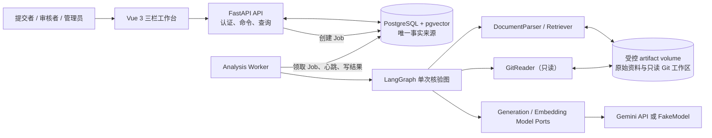
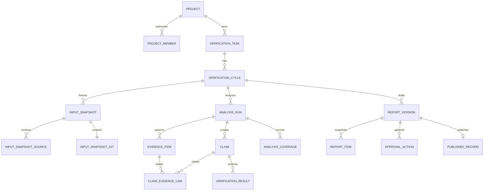
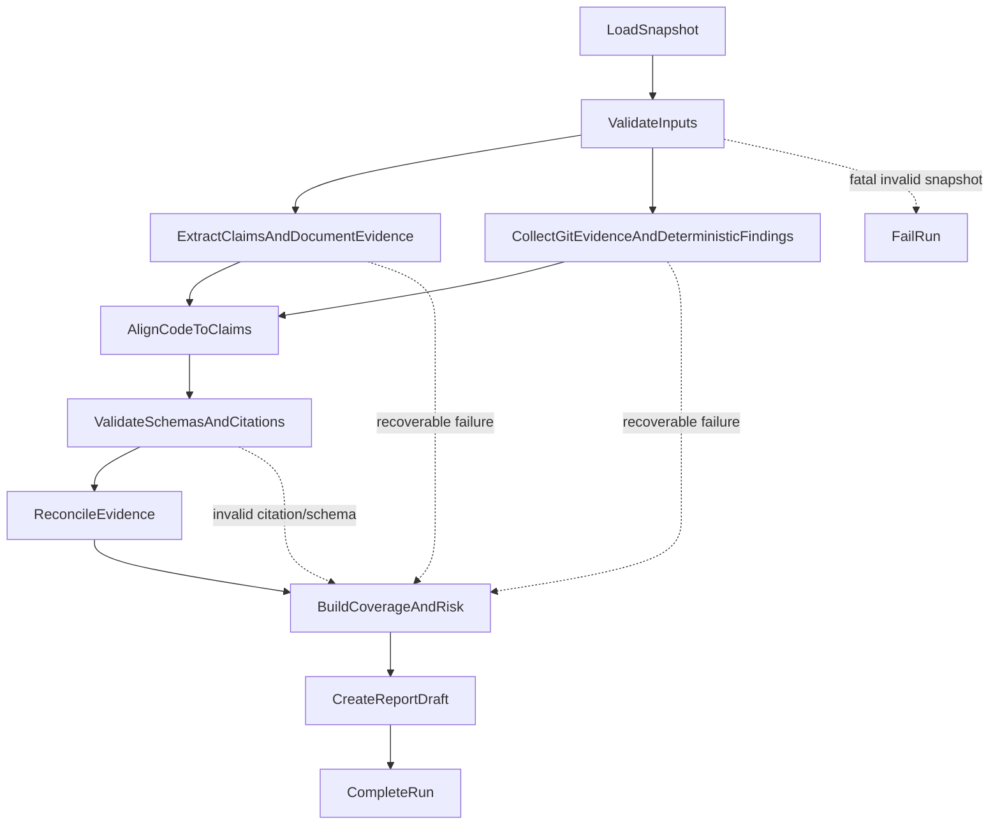

# AI-CodeReview v1 架构设计

> 项目：**AI-CodeReview**
> 副标题：**面向研发交付的多源证据核验与交付记录系统**
> 状态：v1 基线设计，2026-08-01
> 适用仓库：`https://github.com/yyy2045/one.git`

## 1. 目标、边界与质量目标

AI-CodeReview 为一个需求建立一次或多次可追溯的交付核验轮次：它冻结需求资料、设计/验收资料、Git 范围及外部测试证据，异步产生可引用的 Claim、Evidence 和 VerificationResult，随后由人审批并发布不可变交付记录。Git 是多源证据之一，不是产品中心；代码和测试只能证明实际交付，不能改写需求权威。

v1 的质量目标依次为：**可追溯、如实表达不确定性、审批不可抵赖、可恢复、最小可演示**。发布记录必须唯一追溯到一个不可变输入快照；纯模型推断不得形成 `CONFIRMED`；Worker 异常不能丢失任务或伪装为成功；离线 FakeModel 也能完成样例闭环。

不属于 v1：通用聊天、PR 建议工具、在线 IDE/执行器、自动修复或提交、完整 SAST/DAST、微服务/Kafka/Redis/Celery/Temporal、LangChain 全家桶或自治多 Agent、多仓库、OCR/复杂表格、多租户/SSO/计费、WebHook/机器人和移动端。

### 1.1 P0 决策闭合表

| P0 | 最终选择 | 放弃方案与原因 | 后续扩展点 |
|---|---|---|---|
| 运行形态 | 模块化单体：Vue、FastAPI API、独立 Worker、PostgreSQL+pgvector、受控卷，由 Compose 编排 | 进程内后台任务无法可靠恢复；微服务与消息平台超出首月价值 | API 与 Worker 已是独立进程，可在不改领域层时横向扩容 |
| 持久化 | PostgreSQL 是项目、快照、运行、证据、报告、审批、发布的唯一事实来源；文件卷只放原件 | Redis/文件/图 checkpoint 不能成为正式状态源 | `ArtifactStoragePort` 可切换对象存储 |
| 版本身份 | UUID 主键、`timestamptz`、应用层规范化 SHA-256 哈希；输入、报告和发布均不可覆盖 | 分支名和可变文件路径不能作为正式身份 | 可增加外部不可篡改存档 |
| 异步 | PostgreSQL Job + `FOR UPDATE SKIP LOCKED` + 租约心跳 + 有限重试 | Celery/Temporal 增加基础设施 | 可替换 Job 适配器，不改变 `AnalysisRun` |
| AI | LangGraph 只编排单次 `AnalysisRun`；Gemini 是生成适配器，Embedding 独立；FakeModel 保证离线演示 | 通用 Agent/自由多 Agent不可审计、不可预测 | 新 provider 仅实现模型端口 |
| 证据裁决 | Claim、EvidenceItem、ClaimEvidenceLink、VerificationResult 四实体；中心化 CitationResolver | 自由 JSON 证据数组不可查询、不可校验 | 可添加新 evidence source/kind |
| 状态 | 资料、运行、轮次、报告四个独立状态机；审批和发布只由命令用例改变 | 一个“通过”状态会掩盖失败和不确定性 | 可追加新报告工作流，不复用运行状态 |
| 权限 | JWT Bearer、两个演示账户；项目成员 RBAC；后端强制鉴权；提交者不得审批自己的报告 | 仅前端隐藏按钮或先建 SSO 都不满足边界 | 可接 OIDC 适配器，不改变授权判断 |
| Git | 一个登记仓库、只读镜像/工作目录、分析开始时冻结完整 SHA 与 diff 哈希 | 执行仓库代码、hooks、构建会扩大安全面 | 后续可增加受控托管仓库读取器 |
| 前端 | Vue 3 + TypeScript + Vite + Vue Router + Pinia + 可替换轻量 UI 库；三栏工作台、轮询进度 | WebSocket/SSE 不是首版必需 | 可将轮询适配为事件流，不影响 API 资源模型 |

## 2. 系统视图与运行拓扑



Compose 固定为 `frontend`、`api`、`worker`、`postgres` 与具名 `artifact-volume`。`api` 和 `worker` 复用一个后端镜像、代码库、迁移和领域模型，仅启动命令不同。开发机仅映射 `frontend:5173`、`api:8000`、`postgres:5432`；容器内以服务名访问，生产部署不公开 PostgreSQL。API 健康检查为 `GET /health/live` 和 `GET /health/ready`；Worker 健康检查由最近心跳和可领取 Job 轮询组成；PostgreSQL 使用 `pg_isready`。迁移由一个显式、一次性 `migrate` Compose profile/命令执行，绝不由 API 或 Worker 启动时自动执行。

| 环境变量/Secret | 供给对象 | 规则 |
|---|---|---|
| `DATABASE_URL` | api、worker、migrate | 指向 `postgres`；只通过环境或 Secret 注入 |
| `JWT_SECRET`、`JWT_ACCESS_TTL_SECONDS` | api | Secret 不进入镜像、日志或前端 |
| `ARTIFACT_ROOT` | api、worker | 只能指向 `artifact-volume` 内的受控根目录 |
| `GEMINI_API_KEY`、`GEMINI_GENERATION_MODEL`、`EMBEDDING_MODEL` | worker | 未配置时选择 FakeModel/明确错误，绝不静默降级为事实 |
| `WORKER_ID`、`JOB_LEASE_SECONDS`、`JOB_MAX_ATTEMPTS` | worker | 运行配置有默认值并写入 manifest |
| `CORS_ALLOWED_ORIGINS` | api | 开发环境仅本地前端地址，生产按部署显式配置 |

依赖运行基线：Python 3.12、Node.js 22 LTS、PostgreSQL 16、Docker Compose v2。后端使用 FastAPI、Pydantic v2、SQLAlchemy 2、Alembic、PostgreSQL 驱动、pgvector Python 适配、LangGraph、Gemini 官方 SDK 与 pytest；前端使用 Vue 3、TypeScript、Vite、Vue Router、Pinia。首个运行切片将把这些版本精确写入单一 `pyproject`/锁文件与单一 `package.json`/锁文件；任一模块不得自行漂移版本。

### 2.1 建议目录与依赖方向

```text
one/
├─ frontend/                         # Vue 工作台、路由、Pinia、API client
├─ backend/
│  ├─ app/
│  │  ├─ api/                        # FastAPI 路由、认证、请求/响应 DTO
│  │  ├─ application/                # 用例、事务、命令、查询、状态守卫
│  │  ├─ domain/                     # 实体、值对象、领域服务、端口、错误码
│  │  ├─ infrastructure/             # SQLAlchemy、文件、Git、Gemini、日志适配器
│  │  ├─ workflows/                  # LangGraph typed state、节点适配器
│  │  └─ worker/                     # 领 Job、心跳、恢复、执行入口
│  ├─ migrations/                    # Alembic
│  └─ tests/                         # unit / integration / e2e / fixtures
├─ infra/                            # compose、Dockerfile、env 示例
├─ samples/                          # 固定资料、Git 和评测夹具
└─ docs/                             # 架构、API、运行说明
```

依赖只能向内：`api`、`worker`、`workflows`、`infrastructure` 依赖 `application` 和 `domain`；`application` 只依赖 `domain`；`domain` 不依赖 FastAPI、SQLAlchemy、LangGraph、Gemini 或 LangChain。路由不会直接操作 ORM；图节点不会改变轮次、报告、审批或发布状态；它们只调用应用服务并返回经过 Pydantic 校验的结构化 DTO。

## 3. 领域模型、数据字典与版本规则

所有表均带 `id uuid`、`created_at timestamptz`；可变聚合另带 `version integer` 作乐观锁。不可变实体禁止更新内容字段，修订通过新行和父/替代关系表示。状态枚举存为 PostgreSQL enum 或受约束 text，禁止任意字符串。

| 聚合/表 | 关键字段 | 规则 |
|---|---|---|
| `users` | `email`、`password_hash`、`display_name`、`status` | 两个演示账号由种子数据创建；密码哈希从不返回 |
| `projects` | `name`、`description`、`owner_id`、`version` | 项目是资源授权根 |
| `project_members` | `project_id`、`user_id`、`role`=`SUBMITTER/REVIEWER/ADMIN` | `(project_id,user_id)` 唯一；管理员可兼具操作角色 |
| `verification_tasks` | `project_id`、`title`、`requirement_key`、`created_by`、`version` | 一个稳定需求容器；`(project_id,requirement_key)` 唯一 |
| `verification_cycles` | `task_id`、`sequence_no`、`business_status`、`created_from_cycle_id`、`active_run_id`、`version` | `(task_id,sequence_no)` 唯一；已发布轮次不可回退 |
| `source_revisions` | `project_id`、`source_role`、`logical_name`、`revision_no`、`content_hash`、`artifact_uri`、`processing_status`、`parser_version`、`failure_code` | 上传即产生不可变版本；只有 `READY` 可入快照 |
| `document_chunks` | `source_revision_id`、`chunk_index`、`text_hash`、`locator jsonb`、`index_version`、`embedding vector` | 原文位置与资料版本绑定；embedding 换版本新增行 |
| `git_repositories` | `project_id`、`canonical_url_hash`、`display_url`、`credential_ref`、`read_only` | 凭证只存 secret 引用；`read_only=true` 恒成立 |
| `git_snapshots` | `cycle_id`、`repository_id`、`base_sha`、`target_sha`、`merge_base_sha`、`diff_mode`、`include_paths`、`exclude_paths`、`diff_hash`、`coverage_json` | 完整 SHA 必填；分支名仅保留 `selected_ref` 审计字段 |
| `input_snapshots` | `cycle_id`、`snapshot_hash`、`policy_version`、`workflow_version`、`created_by` | `snapshot_hash` 唯一；关联表冻结 source 与 git 输入 |
| `input_snapshot_sources` | `snapshot_id`、`source_revision_id`、`content_hash`、`parser_version` | 一经写入不可改 |
| `input_snapshot_git` | `snapshot_id`、`git_snapshot_id`、`diff_hash` | 一快照一个 v1 Git 范围；为空只允许资料预审，不可启动正式交付核验 |
| `analysis_runs` | `snapshot_id`、`analysis_config_hash`、`run_status`、`manifest_hash`、`checkpoint_ns`、`started_at`、`finished_at`、`cancel_requested_at` | 同一 `(snapshot_hash,analysis_config_hash)` 仅一个活动运行 |
| `analysis_run_manifests` | `run_id`、`workflow_version`、`rule_set_version`、`prompt_set_version`、`generation_model`、`embedding_model`、`schema_version`、`degradation` | 运行环境可追溯，且不属于输入快照 |
| `analysis_jobs` | `run_id`、`idempotency_key`、`job_status`、`lease_owner`、`lease_expires_at`、`heartbeat_at`、`attempt_no`、`max_attempts`、`last_error_code` | `run_id` 与 `idempotency_key` 均唯一；租约过期可恢复 |
| `node_attempts` / `run_events` / `model_calls` | `run_id`、`node_id`、`attempt_no`、`event_type`、`status`、`payload_redacted`、`correlation_id` | 仅追加；技术可观测性不充当业务状态 |
| `claims` | `run_id`、`claim_key`、`claim_type`、`text`、`authority_level`、`source_revision_id`、`version_no` | 由资料理解节点形成；同 run 内 `claim_key` 唯一 |
| `evidence_items` | `project_id`、`snapshot_id`、`source_type`、`evidence_kind`、`source_revision_id`、`commit_sha`、`content_hash`、`excerpt_safe`、`locator jsonb`、`locator_precision`、`extractor_version`、`requires_human_confirmation` | 不可变；资料或 Git 身份至少其一存在 |
| `claim_evidence_links` | `claim_id`、`evidence_id`、`relation`、`reason`、`confidence`、`produced_by`、`requires_human_confirmation` | 关系仅 `SUPPORTS/CONTRADICTS/CONTEXT_ONLY`；组合唯一 |
| `verification_results` | `run_id`、`claim_id`、`protocol_version`、`status`、`reason`、`evidence_ids jsonb`、`requires_human_confirmation`、`produced_by` | 每个 Claim 每 run 一条；保存计算所用 ID 集合 |
| `analysis_coverages` | `run_id`、`scope_kind`、`scope_ref`、`state`、`reason_code` | `ANALYZED/NOT_ANALYZED/FAILED/SKIPPED/UNSUPPORTED/NO_FINDING` 互斥 |
| `risk_findings` | `run_id`、`severity`、`category`、`evidence_id`、`recommendation` | 确定性与 AI 建议以 `finding_kind` 区分 |
| `report_versions` | `cycle_id`、`sequence_no`、`status`、`parent_report_version_id`、`content_hash`、`snapshot_hash`、`run_id`、`submitted_at`、`version` | 提交后 hash 锁定；改动必须新建草稿版本 |
| `report_items` | `report_version_id`、`result_id`、`display_order`、`result_snapshot jsonb`、`citation_snapshot jsonb`、`disposition` | 保存报告当时的结果与引用快照 |
| `approval_actions` | `report_version_id`、`action`、`actor_id`、`reason`、`report_hash`、`snapshot_hash`、`run_id` | 仅追加；拒绝提交者审批本人报告 |
| `published_records` | `task_id`、`cycle_id`、`report_version_id`、`record_no`、`record_hash`、`published_by`、`published_at` | 一份批准且哈希未变报告只能发布一次；不可变 |
| `audit_events` | `project_id`、`actor_id`、`aggregate_type`、`aggregate_id`、`action`、`before_version`、`after_version`、`correlation_id` | 正式命令与审计事件同事务提交 |



`InputSnapshot.snapshot_hash` 是规范化 JSON（资料 ID/哈希/解析版本、规范化仓库身份、完整 SHA、比较语义、路径规则、diff 哈希、外部测试哈希、策略/工作流版本）的 SHA-256。资料补充、资料处理版本变化、Git SHA/路径/比较模式、测试证据变化均创建新快照；不覆盖历史。`AnalysisRunManifest` 持有实际模型、prompt、schema、规则、重试和降级，所以同一快照允许不同配置重跑并可比较。

## 4. 状态机、命令和不变量

```mermaid
stateDiagram-v2
  state "资料处理" as S { [*] --> UPLOADED; UPLOADED --> PARSING; PARSING --> CHUNKING; CHUNKING --> INDEXING; INDEXING --> READY; UPLOADED --> FAILED; PARSING --> FAILED; CHUNKING --> FAILED; INDEXING --> FAILED }
  state "分析运行" as R { [*] --> QUEUED; QUEUED --> RUNNING; RUNNING --> SUCCEEDED; RUNNING --> PARTIALLY_COMPLETED; RUNNING --> FAILED; QUEUED --> CANCELLED; RUNNING --> CANCELLED }
  state "核验轮次" as C { [*] --> DRAFT; DRAFT --> ANALYZING; ANALYZING --> DRAFT_READY; ANALYZING --> NEEDS_EVIDENCE; ANALYZING --> NEEDS_CONFIRMATION; DRAFT_READY --> PENDING_REVIEW; NEEDS_EVIDENCE --> PENDING_REVIEW; NEEDS_CONFIRMATION --> PENDING_REVIEW; PENDING_REVIEW --> REJECTED; PENDING_REVIEW --> APPROVED; APPROVED --> PUBLISHED }
  state "报告版本" as V { [*] --> DRAFT; DRAFT --> SUBMITTED; SUBMITTED --> CHANGES_REQUESTED; SUBMITTED --> APPROVED; APPROVED --> PUBLISHED; PUBLISHED --> SUPERSEDED }
```



| 状态机 | 合法迁移与守卫 |
|---|---|
| 资料 | 上传者有项目写权限；仅当前阶段成功才能前进；失败记录阶段和稳定错误码；只有全部必需资料为 `READY` 才能冻结正式快照 |
| 运行 | `StartAnalysis` 在同一事务创建 `QUEUED` run 与 job；Worker 持有效租约才可 `RUNNING`；取消先记录请求，安全节点边界转 `CANCELLED`；覆盖中有失败转 `PARTIALLY_COMPLETED`，无可用结果转 `FAILED` |
| 轮次 | 冻结快照后 `DRAFT→ANALYZING`；活动 run 终态后应用服务按结果/coverage 转 `DRAFT_READY`、`NEEDS_EVIDENCE` 或 `NEEDS_CONFIRMATION`；只有有锁定报告才能 `PENDING_REVIEW`；批准的报告才能 `APPROVED`；已发布只可通过 `CreateNextCycle` 产生新轮次 |
| 报告 | 草稿可保存；提交锁定 `content_hash`；`CHANGES_REQUESTED` 必须复制为新 `DRAFT`，旧版保留；审核人非提交者且 hash/snapshot/run 一致才可批准；发布只接受 `APPROVED` 且 hash 未变的版本 |

关键不变量：资料处理状态不等于运行状态；运行成功不等于某 Claim 确认；轮次批准不改写 Claim 结果；报告批准不等于发布；LangGraph checkpoint 绝不承载审批状态。所有写命令要求 `Idempotency-Key`、聚合 `version`、权限、状态守卫和单数据库事务；成功后同事务追加 `audit_events`。

## 5. 证据协议、裁决与引用

协议为 `Claim → Evidence[] → VerificationResult → ReportItem → HumanApproval`。`EvidenceItem.locator` 是按 `source_type` 校验的 JSON：文档为页/段/字符/Chunk，代码为完整 commit、路径、hunk、旧新侧和行范围，测试为报告/套件/用例/退出状态，工具为规则/文件/行，人工补证为提交者/说明/附件版本。`locator_precision` 只能是 `EXACT/APPROXIMATE/UNAVAILABLE`；无精确位置只出文件级引用，绝不伪造页码或行号。

裁决服务按以下确定性次序运行：先拒绝无效/越权/非当前快照证据；再按来源权威计算同 Claim 的支持、反驳和上下文集合；最后输出五态之一。权威顺序为：已批准验收/需求 > 已批准设计 > 会议纪要；同级按批准状态、明确版本、时间排序。代码与测试证明“做了什么”，不能覆盖“应做什么”；同级冲突不由模型裁决。仅模型推断或待确认链接最多输出 `INFERENCE_REQUIRES_CONFIRMATION`；有权威支持且无有效反驳才可 `CONFIRMED`；支持不完整为 `PARTIALLY_SUPPORTED`；有效反驳或同级权威冲突为 `CONFLICTING`；没有充分有效支持为 `INSUFFICIENT_EVIDENCE`。

`CitationResolver` 是唯一解析与出站引用服务。它在报告、问答、下载前校验 evidence 存在、项目匹配、快照匹配、调用者成员权限、引用类型和 locator 精度；拒绝不存在、越权、跨快照或已失效的 ID。模型收到的候选列表只含允许的 `evidence_id`，其输出 ID 再经 resolver 复验，不能自行编造。

## 6. API、查询模型与错误

API 前缀为 `/api/v1`，JSON 使用 camelCase，时间为 RFC 3339 UTC，ID 为 UUID。列表统一使用 cursor 分页：`?limit=50&cursor=<opaque>`，响应为 `{items, nextCursor}`；稳定排序为 `createdAt,id`。写操作请求头必须有 `Authorization: Bearer`、`Idempotency-Key` 和 `If-Match: <version>`；创建资源返回 `201`，启动分析返回 `202`。

| 资源/命令 | 方法与路径 | 结果 |
|---|---|---|
| 项目与成员 | `POST /projects`、`GET /projects/{id}`、`PUT /projects/{id}/members/{userId}` | 项目、角色与版本 |
| 任务与轮次 | `POST /projects/{id}/verification-tasks`、`GET /verification-tasks/{id}`、`POST /verification-tasks/{id}/cycles` | 稳定任务与新轮次 |
| 资料 | `POST /cycles/{id}/sources`、`GET /source-revisions/{id}` | 受控上传/登记、处理进度 |
| Git | `POST /projects/{id}/git-repositories`、`POST /cycles/{id}/git-snapshots` | 登记仓库、冻结 SHA 范围 |
| 快照 | `POST /cycles/{id}/input-snapshots` | 验证资料就绪、生成 `snapshotHash` |
| 分析 | `POST /input-snapshots/{id}/analysis-runs`、`POST /analysis-runs/{id}/cancel`、`GET /analysis-runs/{id}` | `202 + analysisRunId`、进度、coverage、事件 |
| 补证与报告 | `POST /cycles/{id}/supplemental-evidence`、`POST /cycles/{id}/report-versions`、`PUT /report-versions/{id}`、`POST /report-versions/{id}/submit` | 新资料/草稿/锁定提交 |
| 审批发布 | `POST /report-versions/{id}/request-changes`、`.../reject`、`.../approve`、`.../publish` | 只追加 approval，发布记录 |
| 问答 | `POST /analysis-runs/{id}/questions` 或 `POST /report-versions/{id}/questions` | 只读 `{answer, factStatus, citations}` |

错误响应固定为 `{code,message,correlationId,details}`。错误码分类：`AUTH_UNAUTHENTICATED`、`AUTH_FORBIDDEN`、`STATE_CONFLICT`、`VERSION_CONFLICT`、`IDEMPOTENCY_CONFLICT`、`INPUT_STALE`、`SOURCE_NOT_READY`、`GIT_RANGE_INVALID`、`CITATION_INVALID`、`MODEL_NOT_CONFIGURED`、`MODEL_UNAVAILABLE`、`MODEL_SCHEMA_INVALID`、`RUN_PARTIAL`、`PARSER_FAILED`、`SYSTEM_ERROR`。HTTP 状态分别使用 401、403、409、422、424、429/503、500；前端展示业务错误码而不从自然语言猜状态。

核心命令的请求/响应形状固定如下，字段名后续只能增加可选字段：

```json
POST /api/v1/cycles/{cycleId}/input-snapshots
{ "sourceRevisionIds": ["uuid"], "gitSnapshotId": "uuid", "policyVersion": "v1" }

201 Created
{ "id": "uuid", "cycleId": "uuid", "snapshotHash": "sha256:...", "status": "FROZEN", "version": 1 }

POST /api/v1/input-snapshots/{snapshotId}/analysis-runs
{ "analysisConfigVersion": "v1" }

202 Accepted
{ "analysisRunId": "uuid", "runStatus": "QUEUED", "pollUrl": "/api/v1/analysis-runs/uuid" }
```

## 7. Worker、LangGraph 与失败恢复

API 的启动用例在同一事务校验快照/权限/轮次，创建 `AnalysisRun(QUEUED)`、`AnalysisRunManifest` 和 `AnalysisJob(QUEUED)`，提交后返回 `202`。Worker 以 `FOR UPDATE SKIP LOCKED` 领取可用 job，写入 `lease_owner/lease_expires_at/heartbeat_at`，每 15 秒心跳一次，租约 60 秒；单次 job 最大尝试 3 次，指数退避 30/120/300 秒。过期租约由另一 Worker 续跑同一 run/checkpoint；取消请求在节点边界检查。唯一活动运行约束为 `(snapshot_hash, analysis_config_hash)`，故重复请求重放原 job，不会重复报告或审批。



`GraphState` 只含 `analysis_run_id`、`input_snapshot_id`、`claim_ids`、`evidence_ids`、`verification_result_ids`、`coverage_id`、`node_errors`、`workflow_schema_version`、`checkpoint_ref`。节点按需经端口读取全文/diff，不能将大段原件或敏感内容持久写入 checkpoint。每个节点输入/输出均为 Pydantic DTO；结构化模型输出有限重试一次，仍非法记 `MODEL_SCHEMA_INVALID` 并进入 `PARTIALLY_COMPLETED`/`NEEDS_CONFIRMATION`，不产生伪结论。模型未配置、配额/网络失败、解析失败、无证据是不同错误和不同 coverage。

节点只能调用 `DocumentParserPort`、`GitReaderPort`、`RetrieverPort`、`GenerationModelPort`、`EmbeddingModelPort`、`ArtifactStoragePort`、`ReportDraftService`。它们不能调用审批/发布命令。`CreateReportDraft` 根据已持久化结果生成可编辑报告；正式审批仍由 API 命令完成。

## 8. 文档、Git、检索、模型与问答

v1 支持 Markdown 和纯文本；可提取文本 PDF 作为可选第二阶段输入，OCR、复杂表格明确后置。上传流写入隔离的项目/资料版本目录，计算哈希后只追加元数据；解析生成有 `source_revision_id` 回链的 Chunk。检索固定为：项目/任务/资料版本/用户权限过滤 → PostgreSQL FTS 与 pgvector 召回 → 去重和最小重排 → 带 Evidence ID 的候选。Embedding 模型或切分规则变化产生新 `index_version`，不覆盖旧索引。

GitReader 仅允许已登记的一个仓库，以最小只读凭证克隆/更新到受控卷；禁用 hooks，不运行源码、构建、脚本或自动提交。冻结 `base_sha/target_sha/merge_base_sha`、two-dot 或 three-dot、路径包含排除和 diff 哈希，并记录重命名、删除、二进制、生成文件、大文件、子模块和解析失败到 `AnalysisCoverage`。测试/构建只作为外部导入证据，必须绑定 commit SHA 与内容哈希。

模型网关仅在 infrastructure。`GenerationRequest/Result` 与 `EmbeddingRequest/Result` 是领域/应用可见 DTO；Gemini SDK 不向内泄漏。每次调用记录 provider、model、prompt/schema/rule 版本、温度、授权输入 Evidence ID、延迟、用量、重试、降级和脱敏错误。`FakeModelAdapter` 输出固定夹具，允许无 API Key 演示。密钥只来自环境/Secret，绝不写数据库明文、普通日志、artifact 或 prompt。

问答仅加载调用者有权访问的指定 run/snapshot/report 及已存在的结构化结果和原始证据；输出固定 `{answer,factStatus,citations}`。它不调用完整核验图、不执行工具写入、不改变状态，问答文本也不自动成为正式 Evidence。所有资料、代码和会议纪要视为不可信模型输入，其中要求改系统规则、泄漏密钥或绕过权限的指令一律按内容忽略。

## 9. 安全、RBAC、审批与前端

JWT Bearer 使用短期 access token；v1 的两个演示账户由种子数据提供，无注册、找回密码、SSO 或用户管理后台。`SUBMITTER` 可创建任务、资料、快照、运行、补证与报告；`REVIEWER` 可审核非本人提交报告；`ADMIN` 管理成员并可审核非本人提交报告。每次资源访问沿 `Project → ProjectMember → Task/Cycle/Source` 检查，前端控制仅改善体验，后端是唯一授权执行点。

批准动作绑定 `report_version_id/content_hash/snapshot_id/snapshot_hash/run_id/actor_id/reason/time`。发布是独立命令，二次校验报告为 `APPROVED`、批准动作有效且 hash 未变，然后在一个事务中写 `PublishedRecord`、轮次 `PUBLISHED` 与审计事件。任何修改都创建新轮次/快照/报告版本；已发布记录不更新。

前端桌面端三栏：左栏“证据来源”（资料状态、Git 范围、外部证据）；中栏“交付核验”（Claim、证据、结果、coverage）；右栏 tabs“核验详情 / AI 问答 / 交付记录”。中央区明确显示资料处理、运行、Claim 结果、报告状态四种状态。代码证据先显示精简结论，按需打开只读高亮 diff，并展示 SHA、hunk、行精度和关联 Claim；不能定位时展示文件级/不可定位。Pinia 仅缓存查询状态；所有写入回读服务端版本。v1 每 3 秒轮询活跃运行，在终态或离页时停止。

| 服务端状态 | 前端位置与含义 |
|---|---|
| `source_revisions.processing_status` | 左栏资料条目：READY/处理中/失败；失败显示阶段和错误码，不能冻结 |
| `analysis_runs.run_status` + Job/节点事件 | 中栏顶部：排队、运行、部分完成、失败、取消；显示 retry 与最后节点，不显示为业务“通过” |
| `verification_results.status` + `analysis_coverages` | 中栏 Claim 卡：五种核验结果及分析/跳过/失败/未发现范围 |
| `report_versions.status` + `approval_actions` + `published_records` | 右栏报告：草稿、已提交、需修改、已批准、已发布/已替代及操作权限 |

## 10. 审计、可观测性、测试与验收

结构化运行日志必须携带 `project_id/task_id/cycle_id/run_id/node_id/model_call_id/correlation_id`，记录耗时、重试、错误类别和 token；人工 `audit_events` 与运行 `run_events` 分表。日志和模型记录只存安全摘要/脱敏关联，不存密钥、Git 凭证、原始敏感文本或无权限 Evidence。

测试层级：领域单元测试状态守卫、裁决和哈希；适配器集成测试 PostgreSQL/pgvector、存储、Git mock、FakeModel；API 契约测试 RBAC、幂等、乐观锁、错误码；Worker 集成测试租约、心跳、超时、取消、恢复；浏览器端到端测试三栏到发布。固定样例必须覆盖确认、部分支持、冲突、无证据、确定性工具命中、AI 建议、非法 Evidence ID、无精确行、模型未配置/不可用、非法 Schema、节点中断恢复、过期快照、越权检索和提示注入。硬指标：已发布 ReportItem 引用可解析率 100%，越权泄漏 0，纯模型推断升为 `CONFIRMED` 为 0，提交者自审拒绝率 100%，节点失败不显示完整成功。

### 10.1 端到端一致性走查

| 路径 | 设计闭环与检查结论 |
|---|---|
| 任务创建 | 提交者在项目授权内创建 Task/Cycle；`version`、审计、幂等和稳定 ID 在事务内完成。通过。 |
| 输入快照 | READY 资料、冻结 Git 完整 SHA/差异、外部证据与策略形成不可变 `snapshot_hash`；变更创建新快照。通过。 |
| 分析运行 | 同事务创建 Run+Job，Worker 租约领取；typed graph 仅写结构化工作产物；过期租约可恢复。通过。 |
| 证据核验 | Claim 后再对齐代码；证据链接、权威规则、CitationResolver 和 Coverage 防止伪造与误判。通过。 |
| 报告草稿 | 结果和引用快照成为可编辑 Draft；提交后哈希锁定，改动派生新版本。通过。 |
| 审批 | 后端检查角色与非自审，审批只追加并绑定报告/快照/run 哈希。通过。 |
| 发布 | 独立命令复验 APPROVED 与哈希，原子写 PublishedRecord 和审计；无覆盖路径。通过。 |
| 新版本 | 已发布输入改变时 `CreateNextCycle` 派生新 Cycle/Snapshot/ReportVersion，不回写历史。通过。 |

### 10.2 架构验收清单

**范围**

- [x] Git 被建模为多源证据之一，而不是整个产品中心。
- [x] 没有引入排除的重型能力。
- [x] 一个需求到一份正式记录的闭环完整。
- [x] 首月存在可交付、可演示的最小垂直切片。

**数据与追溯**

- [x] 正式报告可追溯到唯一不可变 InputSnapshot。
- [x] 资料版本、Git SHA、工作流、Prompt、模型和 Schema 均可追溯。
- [x] Claim、EvidenceItem、ClaimEvidenceLink、VerificationResult 职责清晰。
- [x] 支持、反驳、上下文、冲突、证据不足和推断都能表达。
- [x] CitationResolver 能拒绝不存在、越权或不属于当前快照的 Evidence ID。
- [x] 无精确位置时不会虚构页码或代码行号。
- [x] AnalysisCoverage 能区分未发现、未分析和分析失败。

**状态与恢复**

- [x] 资料、分析运行、核验轮次和报告版本状态完全分离。
- [x] LangGraph checkpoint 不承担正式审批状态。
- [x] Job 具有幂等、租约、心跳、超时、取消和有限重试。
- [x] 输入变化不会覆盖旧分析和旧报告。
- [x] 部分失败有明确状态、覆盖范围和前端表现。

**AI 与权限**

- [x] 图只用于一次核验编排，节点只交换结构化协议。
- [x] 领域层不依赖 LangGraph、LangChain 或 Gemini 类型。
- [x] 交付一致性判断发生在 Claim 形成之后。
- [x] 模型不可用和非法输出不会产生伪结论。
- [x] AI 问答只读并带权限过滤、事实状态和引用。
- [x] 提交者不能审批自己的报告。
- [x] 审批绑定报告哈希和快照哈希，发布后不可变。

**运行与验证**

- [x] Compose 组件、卷、端口、迁移和健康检查明确。
- [x] 密钥只通过环境变量或 Secret 注入。
- [x] 业务、解析、Git、模型和系统错误有稳定分类。
- [x] 评测覆盖确认、部分支持、冲突、证据不足和失败恢复。
- [x] 自动化测试覆盖状态机、越权、引用、幂等和恢复。
- [x] 有从全新环境到发布样例报告的完整验收路径。
- [x] 后续每个实现切片都有中文提交名称。

## 11. ADR、风险与明确推迟

| ADR | 决策 | 结论 |
|---|---|---|
| ADR-001 | 架构形态 | 模块化单体 + 独立 Worker + PostgreSQL Job |
| ADR-002 | 事实来源 | PostgreSQL 为唯一正式状态源，受控卷为原件存储 |
| ADR-003 | AI 编排 | LangGraph typed workflow，不采用 LangChain/通用 Agent |
| ADR-004 | 证据 | 关系型证据协议 + 中心化引用校验 |
| ADR-005 | 版本与发布 | 不可变输入/报告/发布，变更派生新轮次 |
| ADR-006 | 本地演示 | Compose + FakeModel，Gemini 为可选真实适配器 |

主要风险与控制：模型输出不稳以 Schema 校验、有限重试、FakeModel 和降级状态控制；Git 解析复杂性以明确 Coverage 和只读范围控制；原件敏感性以最小权限、脱敏日志和受控卷控制；首月范围以垂直切片和明确后置清单控制。推迟项即第 1 节列出的非 v1 能力；它们不进入首版依赖、核心表或首月计划。

第一个最小实现切片是“**项目内创建核验任务并冻结一个 Markdown 资料版本形成可查询 InputSnapshot**”：以 FakeModel/无模型为前提，先证明权限、不可变哈希、状态守卫、审计、前端任务/资料/快照视图和 API/数据库测试闭环；不在该切片接入 Git、LangGraph、审批或发布。
