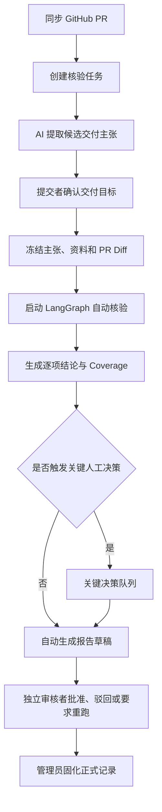
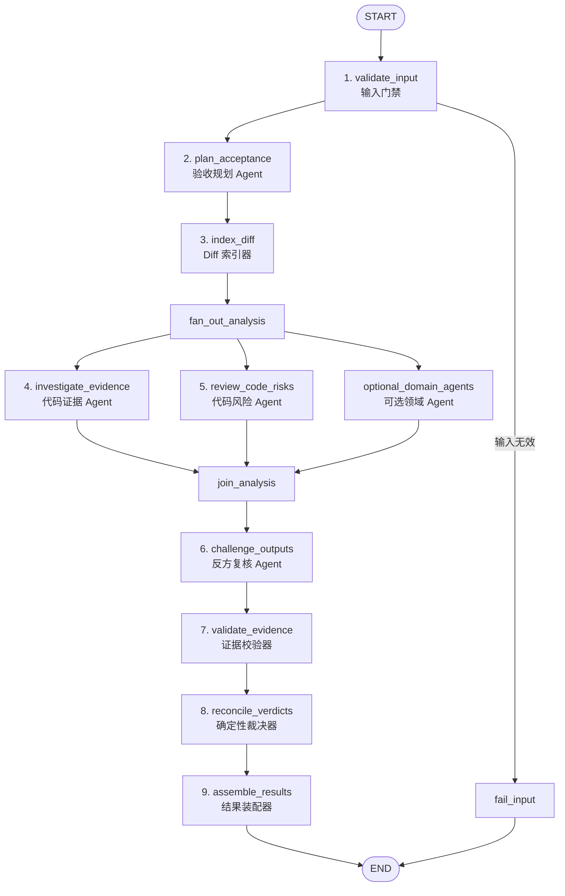

# PR 交付核验 LangGraph 智能体编排设计

> 状态：待用户复核  
> 日期：2026-09-01  
> 适用项目：AI-CodeReview  
> 设计目标：面试容易解释，同时能够增量落地到当前项目

快速阅读版本：[PR 交付核验 LangGraph 编排简明总览](./2026-09-01-pr-delivery-verification-langgraph-overview.md)

## 1. 设计结论

本方案将产品定位为面向研发团队的 **PR 交付核验系统**：针对一次 Pull Request，核验“人工确认的交付目标是否能被本次冻结代码变更支持”，并给出可定位、可回放、可审批的结论。

LangGraph 采用 **固定证据主链 + 专业 Agent + 可选外围 Agent + 确定性裁决器**。模型负责拆解目标、寻找候选证据、发现风险和进行反方复核；程序规则负责输入真实性、引用合法性、覆盖计算和最终状态聚合。

人工不参与日常逐条裁决，只保留三个责任点：

1. 运行前确认“本次要验收什么”；
2. 仅在关键冲突或高风险业务歧义时作出业务决定；
3. 对整份报告进行独立审批并决定是否固化正式记录。

除只读 GitHub PR 与代码仓库外，本方案不依赖 CI、测试平台、Issue 状态或其他外部系统。首版正式输入仅包括：

- GitHub Pull Request 元数据；
- 提交者已确认的交付主张；
- 可选的项目知识库资料；
- 已冻结并带哈希的 PR Git Diff 与受限代码上下文。

## 2. 真实业务场景

以“支付失败重试改造”为例。开发人员提交 PR，并声称已经实现：

- 仅对可重试异常执行重试；
- 同一支付订单不会重复扣款；
- 重试次数受限；
- 失败状态会被正确记录。

传统 PR Review 可以发现局部代码问题，但很难持续回答：

- 本次 Diff 与每条验收目标是什么关系；
- 哪个文件、哪个 Hunk 支持或反驳了结论；
- 哪些目标只实现了一部分；
- 哪些文件因预算、二进制内容或模型失败未被分析；
- 当时基于哪个 PR 版本和哪些资料作出了验收决定。

本系统把这些输入冻结为同一快照，通过固定编排生成逐项交付结论，再由独立审核者对整份报告承担最终业务责任。

## 3. 目标与非目标

### 3.1 目标

1. 每个结论都能够回到当前快照中的具体 Claim 和 Diff Hunk。
2. 相同输入、相同工作流版本应执行相同节点和路由。
3. 模型不能编造文件、行号、Evidence ID 或正式状态。
4. 普通的部分支持、证据不足和低风险 Finding 自动形成结果，不反复要求人工裁决。
5. 只有关键冲突或高风险业务歧义进入人工决策队列。
6. 模型不可用、预算不足和未覆盖范围必须如实展示，不能伪装成“没有问题”。
7. LangGraph 与报告审批状态机分离，便于恢复、审计和权限控制。

### 3.2 非目标

- 不执行仓库代码、Hook、构建或测试；
- 不调用 CI 平台或把测试通过作为首版前置条件；
- 不自动修改代码、提交 Git 或回写 GitHub；
- 不判断整个项目是否完成或是否绝对安全；
- 不允许 Supervisor 自由改变核心核验步骤；
- 不让普通用户编辑核心 Prompt 或绕过固定裁决规则；
- 不用模型输出直接替代正式审批结论。

## 4. 核心信任边界

系统采用四层信任模型：

| 层级 | 职责 | 能否产生正式结论 |
| --- | --- | --- |
| 冻结事实层 | PR 元数据、确认主张、知识库资料、Diff Hunk、哈希和定位 | 提供正式输入 |
| Agent 分析层 | 检查点、证据候选、风险 Finding、反方复核、外围建议 | 不能直接产生正式状态 |
| 程序裁决层 | 校验 Evidence ID、计算 Coverage、聚合支持/冲突和结论 | 可以产生系统核验状态 |
| 人类责任层 | 确认验收范围、处理关键业务冲突、审批正式报告 | 决定业务接受与正式留档 |

这里的 `SUPPORTED` 仅表示：**在当前冻结 PR Diff 和可选资料范围内，代码证据支持该交付主张。** 它不表示代码已经通过运行、测试、上线或生产验证。

## 5. 业务流程与 LangGraph 边界



以下步骤位于 LangGraph 外：

- PR 同步与任务创建；
- 候选交付主张的编辑和确认；
- 正式输入快照冻结；
- 关键业务决定的提交；
- 报告提交、批准、驳回和正式记录固化。

LangGraph 只接收一个已经冻结的 `snapshot_id`，完成自动分析后结束，不使用 `interrupt` 承载人工审批。

## 6. LangGraph 总体拓扑



固定主链不允许外围 Agent 改写。可选领域 Agent 只在冻结编排快照中显式启用，并与代码证据、代码风险节点并行运行。

## 7. Graph State 设计

建议将 State 分为四组，避免 Agent 直接修改正式输入或裁决结果。

```python
class DeliveryVerificationState(TypedDict, total=False):
    # 冻结输入，只能由 validate_input 写入
    run_id: str
    snapshot_id: str
    workflow_version: str
    project_id: str
    pull_request: dict
    confirmed_claims: list[dict]
    document_evidence: list[dict]
    diff_files: list[dict]
    diff_hunks: list[dict]

    # Agent 草稿，不具备正式效力
    acceptance_plans: list[dict]
    evidence_candidates: list[dict]
    code_findings: list[dict]
    domain_advices: list[dict]
    challenges: list[dict]

    # 程序校验和裁决结果
    validated_links: list[dict]
    validated_findings: list[dict]
    coverage: list[dict]
    verdicts: list[dict]
    key_review_flags: list[dict]

    # 运行观测
    node_errors: list[dict]
    degradations: list[dict]
    node_attempts: list[dict]
```

状态约束：

- `confirmed_claims`、`document_evidence` 和 `diff_hunks` 加载后不可修改；
- 每条确认主张携带冻结的 `criticality=NORMAL|CRITICAL`；它可以由模型提出候选，但必须由项目策略或提交者在确认主张时确定；
- Agent 只能追加自己的草稿字段；
- 只有程序节点能写 `validated_*`、`coverage`、`verdicts` 和 `key_review_flags`；
- 每个 Agent 输出都必须携带 `run_id`、`claim_id`、引用 ID 和 schema 版本；
- 正式事实仍持久化在 PostgreSQL，Graph State 只用于本次运行编排和节点间传递。

## 8. 节点详细设计

### 8.1 `validate_input`：输入门禁

类型：程序节点。

职责：读取正式输入快照和冻结编排快照；校验 PR、Claim、知识库资料和 Git Snapshot 属于同一项目及轮次；重新计算 Diff Artifact 哈希；拒绝没有已确认 Claim、缺失 Diff Artifact 或跨项目引用；只将安全摘录和规范化结构放入 Graph State。

输入身份、哈希或权限错误属于硬失败，直接进入 `fail_input`，不调用模型。

### 8.2 `plan_acceptance`：验收规划 Agent

类型：固定核心 Agent。

它把每条已确认 Claim 拆成可观察的代码检查点和检索线索，但不得修改 Claim 原文。

```json
{
  "claimId": "claim-uuid",
  "checkpoints": [
    {
      "key": "CP-1",
      "question": "是否复用同一支付订单的幂等标识",
      "required": true,
      "searchTerms": ["idempotencyKey", "paymentOrderId"]
    }
  ],
  "assumptions": [],
  "schemaVersion": "acceptance-plan-v1"
}
```

每条 Claim 最多拆成 8 个检查点；必须引用已有 Claim ID；不得输出“已完成”等状态；不得虚构资料来源。

### 8.3 `index_diff`：Diff 索引器

类型：程序节点。

它从冻结制品读取规范化文件和 Hunk，提取新增、删除和上下文行，建立路径、类名、函数名和标识符索引，为每个 Hunk 生成不可变 Evidence ID，并记录二进制、空 Diff、超预算和解析失败 Coverage。

只有规范化 Diff Hunk 可以成为正式代码证据。base/target 文件全文只能作为 `CONTEXT_ONLY`，不能单独支持交付结论。

### 8.4 `investigate_evidence`：代码证据 Agent

类型：固定核心 Agent，使用 LangGraph `Send` 按 Claim 并行。

它针对每个检查点，从候选 Hunk 中提出支持、反驳或上下文关系。

```json
{
  "claimId": "claim-uuid",
  "checkpointKey": "CP-1",
  "evidenceId": "evidence-uuid",
  "relation": "SUPPORTS",
  "rationale": "新增逻辑在所有重试请求中复用 paymentOrderId",
  "confidence": 0.84,
  "requiresContext": false
}
```

Agent 只能使用系统提供的 Claim、Checkpoint 和 Evidence ID；只能审查本次 Diff 引入或删除的行为；没有可靠证据时返回空数组。`confidence` 只用于排序，不能直接决定正式状态。

### 8.5 `review_code_risks`：代码风险 Agent

类型：固定核心 Agent，按受预算限制的 Hunk 分组并行。

它只发现本次变更引入的具体代码风险，不负责判断交付目标是否完成。Finding 至少包含类型、严重度、问题、触发场景、建议、精确 Hunk Evidence ID、可选 Claim ID，以及是否需要运行态或外部配置。

没有 Claim 关联的一般代码风险可以进入报告风险章节，但不能自动改变交付结论。

### 8.6 `optional_domain_agents`：可选领域 Agent

类型：受控外围 Agent，例如支付风险、权限边界、数据删除或接口兼容 Agent。

外围 Agent 只能读取裁剪后的 Claim、Hunk 和上下文，输出 `DomainAdvice` 或风险候选；不能写正式链接、裁决或关键人工标记；不能执行仓库代码、调用写工具或读取未冻结远端内容。Prompt 版本和授权范围必须进入编排快照。

### 8.7 `challenge_outputs`：反方复核 Agent

类型：固定核心 Agent。

它对证据候选、代码 Finding 和领域建议进行独立质疑，输出：

- `SUPPORTED`：冻结证据足以保留该候选；
- `UNSUPPORTED`：当前证据无法证明该候选；
- `NEEDS_CONTEXT`：需要运行态、外部配置或未冻结代码才能判断。

反方 Agent 不能修改原始候选、严重度、Claim 或 Evidence，只能追加复核记录。

### 8.8 `validate_evidence`：证据校验器

类型：程序节点。

它验证 Claim、Checkpoint、Evidence、Finding 和 Challenge 属于同一运行，Evidence 来自当前正式快照，路径和 Hunk 可重新定位，枚举合法，反方复核引用原候选证据，并按稳定指纹去重。

进入正式裁决的候选必须同时满足：结构校验成功、证据定位成功、反方复核为 `SUPPORTED`。`NEEDS_CONTEXT` 只保留为限制说明或关键决策触发条件，不能计作正式支持或反驳关系。

### 8.9 `reconcile_verdicts`：确定性裁决器

类型：程序节点，不调用模型。

裁决对象为每条 Claim：

| 状态 | 含义 |
| --- | --- |
| `SUPPORTED` | 所有必需检查点都有经过校验的支持证据，且没有有效反驳 |
| `PARTIALLY_SUPPORTED` | 至少一个必需检查点有支持证据，但仍有必需检查点未被支持 |
| `NOT_PROVEN` | 分析正常完成，但没有找到足够的有效支持证据 |
| `CONFLICTING` | 存在经过校验的反驳证据，或者支持与反驳证据同时存在 |
| `NOT_ANALYZED` | 因输入制品、模型或预算问题，本轮没有完成足够分析 |

确定性优先顺序：

```text
分析未完成 → NOT_ANALYZED
存在有效反驳 → CONFLICTING
全部必需检查点有有效支持 → SUPPORTED
部分必需检查点有有效支持 → PARTIALLY_SUPPORTED
没有有效支持 → NOT_PROVEN
```

### 8.10 `assemble_results`：结果装配器

类型：程序节点。首版不使用模型生成正式报告文案。

它按 Claim 装配状态、理由、检查点覆盖和引用，分离交付结论与代码风险，汇总文件、Hunk、Agent 调用和未覆盖范围，计算关键人工决策标记，并生成供报告服务保存的结构化结果。

未来可以增加自然语言解释 Agent，但其输出只能作为非正式摘要，正式报告仍由结构化模板生成。

## 9. 并行与条件路由

### 9.1 并行策略

- `investigate_evidence` 按 Claim 并行；
- `review_code_risks` 按 Hunk 组并行；
- 可选领域 Agent 与上述两个分支并行；
- `challenge_outputs` 等全部分支汇合后统一运行；
- `validate_evidence` 和 `reconcile_verdicts` 必须串行，避免部分草稿提前形成正式状态。

### 9.2 路由规则

| 条件 | 路由 |
| --- | --- |
| 快照、哈希、项目归属或 Claim 不合法 | `fail_input → END` |
| Diff 合法但没有文本 Hunk | 跳过模型节点，生成 `NOT_ANALYZED` 与 Coverage |
| 验收规划 Agent 失败 | 对受影响 Claim 生成 `NOT_ANALYZED`，其他 Claim 继续 |
| 证据 Agent 失败 | 对受影响 Claim 降级，不把失败解释为 `NOT_PROVEN` |
| 风险 Agent 失败 | 交付证据分支继续，风险 Coverage 标记失败 |
| 可选领域 Agent 失败 | 主链继续，记录外围降级 |
| 反方 Agent 失败 | 未复核候选不能进入高可信自动支持，保留 Coverage |
| 程序校验失败 | 丢弃无效候选并记录稳定错误码 |

Graph 内不存在等待人工输入的路由。`key_review_flags` 只是运行输出，人工决策由 Graph 外的业务服务处理。

## 10. 关键人工决策规则

系统把“证据结论”和“是否需要业务负责人介入”分开：

```text
verdict = CONFLICTING
key_review_required = true / false
```

只有以下情况设置 `key_review_required=true`：

1. 同一必需检查点同时存在经过校验的支持与反驳证据；
2. 已确认的高风险交付目标存在 `NEEDS_CONTEXT`，代码本身无法判断正确业务语义；
3. 经过反方复核仍成立的高严重度 Finding 直接影响支付、权限或不可逆数据操作；
4. 项目策略明确要求某类关键改动必须由指定角色确认。

人工可选择：

- `REJECT_DELIVERY`：拒绝本轮交付；
- `REQUEST_NEW_CYCLE`：要求修改代码或补充资料后重新冻结并运行；
- `ACCEPT_WITH_EXCEPTION`：记录明确例外理由后允许报告进入审批。

人工不能把原始 `CONFLICTING` 改写为 `SUPPORTED`。业务决定作为附加记录保存，系统原始结论保持不变。

`PARTIALLY_SUPPORTED`、`NOT_PROVEN`、普通低中风险 Finding、被反方否定的 Finding、外围普通建议以及 Coverage 缺口都不会触发逐项人工裁决。

## 11. Coverage 与失败语义

Coverage 不是完成率，也不能推出“没有风险”。至少记录：

- 冻结文件数、文本文件数、二进制文件数；
- Hunk 总数、进入 Agent 的 Hunk 数和未进入原因；
- 每条 Claim 的必需检查点数量及已分析数量；
- 模型调用成功、失败、超时或结构校验失败；
- 因 Token 预算裁剪的文件和 Hunk；
- Finding 总数及反方复核状态；
- 可选领域 Agent 的运行与降级状态。

### 11.1 硬失败

- 快照不存在或跨项目；
- Diff Artifact 缺失或哈希不一致；
- 没有已确认 Claim；
- 冻结编排缺少固定核心节点。

硬失败终止整个 Graph。

### 11.2 可降级失败

- 单条 Claim 规划失败；
- 某组 Hunk 超出预算；
- 单个模型节点超时或返回无效结构；
- 可选领域 Agent 不可用；
- 某条候选无法通过引用校验。

可降级失败不伪装成成功；受影响范围输出 `NOT_ANALYZED` 或明确 Coverage，其他分支继续。

## 12. 持久化与审计

建议继续以 PostgreSQL 为正式状态源，LangGraph 不承载报告审批事实。

需要持久化的运行对象：

- `AnalysisRun`：本次自动核验运行；
- `AnalysisRunManifest`：模型、Prompt、Schema、预算和工作流版本；
- `NodeAttempt`：节点尝试次数、状态、耗时和稳定错误码；
- `AcceptancePlan`：Claim 的检查点快照；
- `EvidenceItem`：冻结 Diff Hunk；
- `EvidenceCandidate` / `ClaimEvidenceLink`：Agent 候选与程序校验结果；
- `CodeReviewFinding`：代码风险；
- `FindingChallenge`：反方复核；
- `AnalysisCoverage`：分析范围与降级；
- `VerificationResult`：确定性逐项结论；
- `KeyReviewFlag`：关键人工决策触发原因；
- `RunEvent`：可回放的运行事件。

幂等与不可变要求：

- 同一 `run_id + node_id + input_hash + schema_version` 只能形成一个成功节点产物；
- Agent 重试只能追加新的 ModelCall/Attempt，不能覆盖历史失败；
- 同一运行的候选和 Finding 使用稳定指纹去重；
- 新 Prompt、模型、Diff 或 Claim 必须创建新运行或新轮次；
- 报告审批仍绑定报告哈希、快照哈希和运行 ID。

## 13. 与当前项目的映射

当前项目已经具备可复用基础：

| 现有能力 | 设计中的位置 |
| --- | --- |
| `DeliveryClaimDraft` 与人工确认 | Graph 外的交付目标确认 |
| `InputSnapshotClaim` | 冻结 Claim 输入 |
| Git Diff Artifact 与 Hunk Evidence | `validate_input`、`index_diff` |
| `review_code` | `review_code_risks` 的基础 |
| `challenge_code_findings` | `challenge_outputs` 的基础 |
| `summarize_code_coverage` | Coverage 汇总基础 |
| `link_deterministic` / `propose_model_links` | 候选生成与程序校验两层 |
| `reconcile` | `reconcile_verdicts` 的基础 |
| `run_custom_agents` | `optional_domain_agents` 的基础 |
| `NodeAttempt`、`RunEvent` | 节点观测与回放 |
| 报告、审批和 PublishedRecord | Graph 外业务状态机 |

主要语义调整：

1. 不再要求 CI/测试证据才能输出“当前冻结代码证据支持”；
2. 将现有“需要人工确认”从普通部分支持结果中移除；
3. 新增独立的 `key_review_required`，只标识关键冲突和高风险业务歧义；
4. 将验收规划、证据调查、风险审查和反方复核的输入输出契约进一步拆开；
5. 正式结果装配使用结构化模板，不让解释性模型改写裁决。

历史记录不重写。新语义必须通过新的 `workflow_version`、`protocol_version` 和追加迁移引入。

### 13.1 接口边界

建议复用现有启动和查询入口，并只补充关键决策投影：

| 用途 | 接口 |
| --- | --- |
| 启动自动核验 | `POST /input-snapshots/{snapshotId}/analysis-runs` |
| 查询运行和节点事件 | `GET /analysis-runs/{runId}`、`GET /analysis-runs/{runId}/events` |
| 查询逐项交付结论 | `GET /analysis-runs/{runId}/results` |
| 查询 Diff、Finding、Challenge 和 Coverage | `GET /analysis-runs/{runId}/code-review` |
| 查询关键决策项 | `GET /analysis-runs/{runId}/key-review-flags` |
| 提交关键业务决定 | `POST /analysis-runs/{runId}/key-review-flags/{flagId}/decision` |
| 查看自动报告草稿 | 复用项目报告版本查询接口 |

关键决定接口只能追加业务处置记录，不能修改 `VerificationResult.status`。运行结束且所有必须处置的关键标记已有决定后，报告服务自动创建或解锁草稿；没有关键标记时直接生成草稿。

## 14. 示例运行：支付失败重试改造

### 14.1 冻结输入

```text
PR #128：增加支付失败重试
Claim-1：仅对临时异常重试
Claim-2：重试不能造成重复扣款
Claim-3：最多重试三次
Diff：PaymentService.java、RetryPolicy.java、PaymentRepository.java
```

### 14.2 验收规划

```text
Claim-2
  CP-1：是否生成或复用幂等键（必需）
  CP-2：重试是否保持同一订单身份（必需）
  CP-3：重复请求是否返回已有结果（可选）
```

### 14.3 Agent 分析

- 代码证据 Agent 在 `RetryPolicy.java` 找到重试次数限制，支持 Claim-3；
- 在 `PaymentService.java` 找到订单号复用，部分支持 Claim-2；
- 没有找到幂等键或唯一约束相关变更；
- 代码风险 Agent 提出“并发重试可能重复创建支付记录”；
- 反方 Agent 判断该 Finding 有明确调用路径和 Hunk 支持，应当保留。

### 14.4 程序裁决

```text
Claim-1：SUPPORTED
Claim-2：PARTIALLY_SUPPORTED
Claim-3：SUPPORTED

高严重度风险：并发重试可能重复创建支付记录
key_review_required：true
```

系统不会要求用户重新判断 Claim-1 和 Claim-3，也不会让用户手工把 Claim-2 选成某个状态。人工只需要决定关键风险的业务处置：拒绝交付、要求新一轮修改，或记录例外后进入报告审批。

## 15. 测试设计

### 15.1 程序节点测试

- 快照哈希、项目归属和 Claim 冻结校验；
- Diff 文件、Hunk、删除行、重命名和二进制解析；
- Evidence ID、行号和跨运行引用拒绝；
- 五种核验状态的确定性规则；
- `key_review_required` 的触发与非触发矩阵；
- Coverage 对预算、空 Diff 和失败节点的统计。

### 15.2 Agent 契约测试

- 虚构 Claim/Evidence ID 被拒绝；
- 无可靠证据时返回空候选；
- 上下文全文不能充当正式 Diff 证据；
- Finding 必须包含触发场景和精确 Hunk；
- 反方 Agent 不能修改原始 Finding；
- 无效 JSON、超时和模型不可用产生明确降级。

### 15.3 Graph 路由测试

- 正常输入走完整固定主链；
- 多 Claim 使用 `Send` 并行后稳定汇合；
- 单 Claim 失败不影响其他 Claim；
- 可选领域 Agent 失败不阻断固定主链；
- 硬失败不调用模型；
- Graph 内不会进入人工等待状态。

### 15.4 业务闭环测试

- PR → 确认 Claim → 冻结 Diff → 自动核验 → 自动草稿；
- 普通 `PARTIALLY_SUPPORTED` 可直接生成草稿，不要求逐条裁决；
- 关键冲突进入决策队列，但不改写系统原始结论；
- 不同成员完成报告审批；
- 固化记录能够回放 Claim、Hunk、Coverage、Agent 输出和审批哈希。

测试不得通过执行被核验仓库代码来制造成功结果，也不得用 Fake 模型冒充真实模型 E2E。

## 16. 验收标准

1. 用户只需确认交付目标，不需要逐条替系统判断结果；
2. 普通 PR 可以自动完成从冻结输入到报告草稿的主流程；
3. 每条结论至少能够展示 Claim、检查点、有效 Hunk 和 Coverage；
4. 模型编造或跨快照引用无法进入正式结果；
5. `PARTIALLY_SUPPORTED` 和 `NOT_PROVEN` 不触发人工暂停；
6. 只有关键冲突和高风险业务歧义进入关键决策队列；
7. 人工决定不会覆盖系统原始裁决；
8. 模型失败与未覆盖范围不会显示成“没有问题”；
9. 报告审批和正式记录不依赖 LangGraph 内部 checkpoint；
10. 面试时能够用“AI 分析、程序裁决、人类负责关键业务责任”在两分钟内讲清系统价值。

## 17. 面试讲解口径

可以将这套编排概括为：

> 我们没有设计一个自由决策的 Supervisor，而是把软件交付核验拆成固定证据流水线。验收规划 Agent 将人工确认的交付目标翻译为代码检查点，代码证据 Agent 在冻结 Diff 中寻找支持或反驳证据，代码风险 Agent 发现本次变更引入的问题，反方 Agent 再对这些结果进行质疑。所有模型输出都必须引用系统提供的 Claim 和 Hunk ID，并经过程序校验。最终状态由确定性裁决器生成，普通的部分支持和证据不足自动形成报告，只有关键冲突或高风险业务歧义才进入人工决策。这样既利用了大模型理解代码和语义的能力，又避免让模型直接决定正式交付结论。

一句话总结：

> **AI 负责理解、找证据和互相质疑；程序负责验证与裁决；人只负责关键业务责任。**
