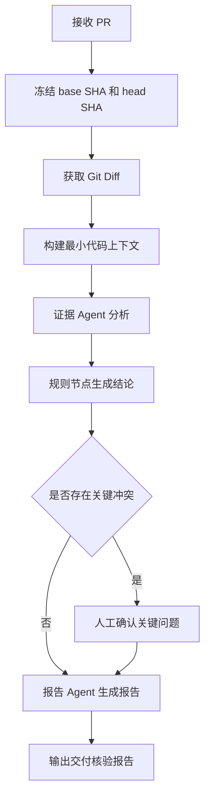

# PR 交付核验 LangGraph 简易链路

> 用途：快速理解项目最终采用的 PR 交付核验流程，便于方案沟通和面试讲解。
> 完整设计：[PR 交付核验 LangGraph 智能体编排设计](./2026-09-01-pr-delivery-verification-langgraph-design.md)

## 1. 项目解决什么问题

开发人员提交 PR 并声明完成了某项需求，但 PR 标题和代码改动之间不一定完全一致。本系统根据 PR 信息、固定版本的 Git Diff 和必要的最小代码上下文，自动判断每项交付目标是否有代码证据支持。

系统不接入 CI，也不宣称代码已经运行、测试或上线。它只回答：

- PR 声称完成了什么；
- 代码实际修改了什么；
- 修改是否支持交付目标；
- 哪些目标只完成了一部分或缺少证据；
- 哪些关键冲突需要人工确认。

一句话定位：

> 对一次 PR 做“交付目标与代码证据”的自动核验。

## 2. 最终技术方案

采用“固定主链路 + 一次受控补充上下文 + 关键问题人工确认”的方式：



其中：

- GitHub API 负责获取 PR 元数据；
- 本地只读 Git 仓库负责获取 Diff 和源码；
- Tree-sitter 负责定位变更所在的方法、类和直接关联符号；
- 证据 Agent 负责理解代码事实；
- 确定性规则负责生成正式结论；
- 人只处理少量关键冲突。

## 3. LangGraph 节点

### 3.1 PR 接入节点

通过 GitHub API 获取：

- PR 标题和描述；
- 仓库地址和 PR 编号；
- `base_sha` 和 `head_sha`；
- 作者等基础元数据。

### 3.2 输入冻结节点

本次分析固定在：

```text
仓库 + base_sha + head_sha
```

后续所有 Diff 和代码上下文必须从这两个 SHA 读取，不能使用可能继续变化的分支名称。

### 3.3 Git 证据节点

使用只读 Git 命令获取 PR 的真实改动：

```bash
git diff <base_sha>..<head_sha>
```

Diff 被解析为文件、Hunk、行号、新增代码和删除代码。它是判断“本次 PR 改了什么”的直接证据。

### 3.4 最小上下文节点

只看 Diff 可能缺少方法和跨文件关系，因此系统按以下顺序补充必要上下文：

```text
解析 Diff 变更行
    → git show head_sha:变更文件
    → Tree-sitter 定位完整方法或类
    → 识别 import、接口、调用对象和配置
    → 本地符号索引定位直接关联文件
    → git show head_sha:关联文件
    → 截取一层关联方法或类
```

上下文扩展遵守以下限制：

- 最多扩展一层直接关系；
- 限制文件数量、单文件大小和总字符数；
- 同名符号无法唯一确定时不猜测；
- 上下文用于解释 Diff，不替代 Diff 成为改动证据。

证据 Agent 如果发现缺少决定结论的代码，可以发出一次结构化上下文请求。系统校验 SHA、路径、关系和预算后读取代码，再允许 Agent 分析一次，禁止无限递归查找。

### 3.5 证据 Agent

第一版只设置一个证据 Agent。它接收：

```text
PR 描述 + 交付目标 + Git Diff + 变更方法 + 一层关联代码
```

它负责输出：

- 代码中可以确认的客观变化；
- 哪些变化支持交付目标；
- 哪些目标缺少证据或被代码反驳；
- 对应文件、方法和 Diff 行号；
- 是否确实需要补充上下文。

Agent 只能提交结构化候选分析，不能执行任意 Git 命令，也不能直接决定正式结论。

### 3.6 确定性裁决节点

程序校验证据引用和分析覆盖范围，并按照固定规则输出：

| 状态 | 含义 |
| --- | --- |
| `SUPPORTED` | Diff 和必要上下文能够支持交付目标 |
| `PARTIALLY_SUPPORTED` | 只支持目标的一部分 |
| `NOT_PROVEN` | 存在代码变化，但不足以证明目标效果 |
| `CONFLICTING` | PR 声明与代码事实存在冲突 |
| `NOT_ANALYZED` | 输入、文件、模型或预算问题导致未完成分析 |

证据不足不能被写成“功能未实现”；系统只能说明当前证据没有证明它。

### 3.7 关键人工确认节点

普通的 `PARTIALLY_SUPPORTED`、`NOT_PROVEN` 和一般代码风险直接进入报告，不暂停流程。只有以下情况才要求人工确认：

- 涉及支付、资金、权限等关键业务；
- PR 声明与代码事实明显冲突；
- 符号歧义会直接改变最终结论；
- 多项强证据互相矛盾；
- 系统准备输出高风险否定结论。

人工只回答一个具体业务问题，确认一次后流程继续，不逐条裁决 Agent 的全部分析。

### 3.8 报告节点

报告 Agent 根据已经裁决的结构化结果生成报告，内容包括：

1. PR 声明的交付目标；
2. Diff 中可以确认的实际改动；
3. 使用了哪些必要上下文；
4. 每项交付目标的核验状态；
5. 缺少的证据和未覆盖范围；
6. 关键人工确认记录；
7. 文件、方法和 Diff 行号引用。

报告 Agent 只能组织表达，不能改变裁决状态。

## 4. Git 仓库运行机制

系统不为每个 PR 完整克隆一份仓库，而是为每个仓库维护一份共享只读缓存：

```text
收到 PR
    → 根据仓库 URL 获取仓库级锁
    → 首次使用执行 blobless、no-checkout clone
    → 后续使用执行 fetch --prune
    → 释放仓库级锁
    → 各 PR 按固定 SHA 并发执行 diff 和 show
```

运行保护包括：

- `clone/fetch` 设置超时并禁止交互；
- 同一个仓库的 `clone/fetch` 串行，不同仓库可以并行；
- 第一次克隆先写入临时目录，成功后原子切换；
- 缓存记录最后使用时间；
- 根据 TTL 和磁盘水位清理闲置仓库；
- 清理前确认没有任务正在使用目标仓库。

## 5. 示例：优化用户支付二维码

PR 声明：

> 优化用户支付二维码。

Diff 实际显示：

- 二维码颜色发生变化；
- 二维码提供商由 A 切换为 B。

Tree-sitter 和最小上下文可以确认修改确实位于二维码组件和提供商配置中，但没有运行数据能够证明扫码成功率或生成速度得到提升。

因此：

| 交付目标 | 结论 |
| --- | --- |
| 修改二维码颜色 | `SUPPORTED` |
| 切换二维码提供商 | `SUPPORTED` |
| 提高扫码成功率 | `NOT_PROVEN` |
| 同时声称完成样式调整和成功率提升 | `PARTIALLY_SUPPORTED` |

系统不会直接判断“二维码优化已全部完成”，而是把模糊目标拆回能够由代码证明的客观事实。

## 6. LangGraph 状态数据

Graph 中保留一份统一状态：

```text
PR 元数据
base_sha / head_sha
交付目标
Git Diff
ContextBundle
Agent 候选分析
校验后的证据引用
逐项目核验结论
key_review_required
最终报告
```

各节点只读取自己需要的字段，并把结构化结果写回状态，避免依赖自然语言在节点之间传递关键数据。

## 7. 异常处理

| 异常 | 处理方式 |
| --- | --- |
| Git 拉取超时 | 终止命令并记录输入获取失败 |
| 凭据缺失或失效 | 禁止交互，立即返回稳定错误 |
| 文件过大或上下文超限 | 保留 Coverage，输出 `NOT_ANALYZED` 或降低结论范围 |
| 关联符号存在歧义 | 不猜测；仅在影响关键结论时进入人工确认 |
| 模型输出格式错误 | 校验失败后进行有限重试，仍失败则记录未分析 |
| 引用不属于冻结 SHA | 拒绝该证据引用 |

## 8. 面试讲解版本

可以概括为：

> 我们通过 GitHub API 获取 PR 元数据，通过本地只读 Git 仓库冻结 base SHA 和 head SHA，并使用 Git Diff 获取直接变更证据。为了避免模型只看局部 Diff 产生误判，系统再通过 Tree-sitter、符号索引和 `git show` 补充一层必要代码上下文。证据 Agent 负责理解代码事实，但正式结论由确定性规则生成；只有支付、权限等关键冲突才进入人工确认，普通证据不足会自动进入报告。这样既发挥了模型的代码理解能力，也保证了结论可追溯、流程可控。

最核心的一句话：

> AI 负责理解代码，程序负责约束证据和裁决，人只负责关键业务责任。
